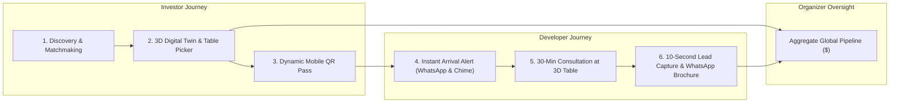

# Autonomous Real Estate Expo & Meeting Management Platform
## UI/UX Design System & 3D Table Visualizer Specification
*100% Self-Contained Standalone Operating System with Three.js/WebGL Digital Twin*

---

## 1. System Ecosystem & Seamless Lifecycle Synergy

The UI/UX across all three portals (Customer, Developer, and Organizer Admin) is designed to operate as a frictionless feedback loop featuring an **interactive 3D Digital Twin** for table exploration and booking.

---

## 2. 3D Spatial Digital Twin & Table View Experience

### 2.1 Visual Design & Luxury Real Estate Aesthetics
- **Theme**: Obsidian slate surfaces (`#0B1120`), marble floor grids with subtle gold Cartesian lines, and semi-transparent frosted acrylic booth partitions.
- **3D Table Elements**:
  - Cylindrical meeting pedestals with 4 floating executive armchair meshes.
  - Floating 3D holographic badges hovering directly above each table:
    - 🟢 `T-1 ● AVAILABLE` (Emerald green aura, ready for instant selection)
    - 🔵 `T-2 ● OCCUPIED (18m left)` (Sapphire blue with pulsing concentric arrival wave)
    - 🟡 `T-3 ● RESERVED 15:00` (Subtle champagne gold outline)
    - 🟠 `T-4 ● WALK-IN READY` (Amber ring: recycled from 15-min no-show)
    - 🟣 `VIP POD A ● PRIVATE` (Royal purple acoustic glass isolation chamber)

### 2.2 Interactive 3D Camera Controls
- **Touch & Mouse Orbit**:
  - Click & drag (or 1-finger swipe): 360° orbital rotation around the booth/hall center.
  - Scroll wheel (or 2-finger pinch): Smooth exponential zoom in/out with boundary clamping.
  - Right-click drag (or 2-finger pan): Pan across different exhibition halls.
- **Preset View Buttons**:
  - `[Isometric 45°]`: Default luxury bird's-eye perspective.
  - `[Top-Down 2D]`: Technical CAD view for precision table alignment.
  - `[Booth B-14 Focus]`: Auto-smooth camera dolly directly inside Emaar's pavilion.
  - `[VIP Lounge View]`: Centers on the private acoustic negotiation pods.
- **Click-to-Book Raycasting**:
  - Hovering over a 3D table illuminates the mesh and displays an interactive tooltip with table number, assigned sales rep, and next open slot.
  - Clicking any 3D table immediately triggers the **1-on-1 Consultation Drawer** pre-selected to that exact physical table.

### 2.3 2D Hall Image to 3D Spatial Presentation Modes
- **Mode 1: `[🗺️ 2D Hall Image Projection]`**:
  - Projects the uploaded 2D hall CAD plan or image onto a dark titanium 3D pedestal in WebGL.
  - Retains authentic architectural aisle labels, entrance portals, and developer boundaries.
  - 3D tables cast realistic drop contact shadows directly onto the hall graphic.
- **Mode 2: `[🏢 3D Wall Pop-Up Extrusion]`**:
  - Procedurally extrudes booth perimeter walls vertically ($2.8\text{m}$ / $Y = -48\text{px}$) from the 2D floorplan.
  - Renders semi-transparent frosted acrylic glass partitions, gold top edge rails, and suspended 3D signboards.
- **Mode 3: `[⚡ Dark Hologram Grid]`**:
  - Minimalist cyber titanium grid with coordinate axes for low-bandwidth devices.
- **Volumetric Hologram Beacons (`[💡 Beacons: ON/OFF]` Toggle)**:
  - Vertical glowing light columns shooting upward from each table with live status color codes and pulsing halo rings.
- **Interactive Image Uploader**:
  - `[📁 Upload Your Hall Image]` file input enabling organizers or investors to drop any custom exhibition floorplan and preview it mapped live in 3D space.

### 2.4 Hall 3 Architectural Layout & 48-Table Grid Experience
- **Calibrated directly from `hall3_floorplan.jpeg` ($88\text{m} \times 55\text{m}$)**:
  - **Zone 1 (Cyan `#06B6D4`)**: الاستلام الفوري والفندقي (Booths B1–B9, B19–B26) • 12 Tables (T1–T12).
  - **Zone 2 (Purple `#8B5CF6`)**: أكتوبر وزايد والساحل والسخنة (Booths B10–B18, B27–B34) • 12 Tables (T13–T24).
  - **Zone 3 (Emerald `#10B981`)**: التجمع الخامس والقاهرة الجديدة (Booths B35–B42, B51–B58) • 12 Tables (T25–T36).
  - **Zone 4 (Coral `#F97316`)**: العاصمة الإدارية الجديدة (Booths B43–B50, B59–B66) • 12 Tables (T37–T48).
  - **Special VIP Booth B67 ($8\times 4\text{m}$)**: كبار المستثمرين VIP Majlis • 2 Negotiation Pods.
- **Total Capacity Matrix**: Exactly 48 meeting tables and 192 negotiation armchairs matching the architectural specification.
- **Zone Focus Navigation & Strict Table Isolation**:
  - Selecting any zone filter button (`[🏙️ Zone 1]`, `[🌊 Zone 2]`, `[💎 Zone 3]`, `[🏛️ Zone 4]`, or `[👑 VIP B67]`) or clicking any zone card below the canvas **strictly isolates that zone's tables and hides all other tables from the 3D scene**.
  - Raycasting only interacts with the visible tables to eliminate accidental clicks on hidden zones.
  - An interactive floating status pill (`[🔍 تم تصفية: ... • إظهار الكل ✕]`) provides 1-click restoration of all 50 tables.

---

## 3. Screen-by-Screen User Flow (Customer Portal)

#### Screen 1.1: Intelligent Matchmaking Feed
- Asset class and budget filters (*Villas, Towers, Commercial, Land*).
- Developer showcase cards featuring project ROI %, booth code, and active sales rep count.

#### Screen 1.2: 3D Digital Twin & Table Selection Hub
- Full-screen or modal interactive 3D WebGL canvas.
- Attendee rotates the 3D model, visually inspects the developer booth, and clicks an available table (e.g., *Table 1 - Window Side*).

#### Screen 1.3: 3-Step Interactive Booking Drawer
- **Step 1 (Day Selector)**: Segmented control for Expo Day 1, Day 2, Day 3.
- **Step 2 (Specialist Selection)**: Choose specialist (e.g., *Tariq Al-Mansoor - VIP Director*).
- **Step 3 (30-Minute Time Slot Grid)**: Morning and afternoon slots with instant Redis collision checks.

#### Screen 1.4: Dynamic Anti-Fraud QR Pass
- Dynamic time-based QR code with 60-second anti-screenshot pulsing token.
- Big CTA: **`[🔔 I Have Arrived at the Booth]`** (triggers immediate WhatsApp alert & audio chime on rep's tablet).

---

## 4. Developer / Exhibitor Portal Specifications

#### Screen 2.1: 3D Booth Command & Table Timeline
- Live 3D status visualizer paired with the 4-table schedule timeline.
- Visual alerts: Table 2 pulses blue when attendee arrives.
- **Walk-In Action**: "+ Seat Walk-In" button for idle or recycled no-show tables.

#### Screen 2.2: Inbound Review Queue
- Investor declared budget ($4.2M), target asset type, and requested slot.
- 1-click **Approve**, **Counter-Propose Alternative Slot**, or **Decline**.

#### Screen 2.3: 10-Second Lead Capture (Native CRM)
- Rating: `HOT 🔥` / `WARM ☀️` / `COLD ❄️`.
- Deal size input slider ($2.5M).
- Checkbox: `[✓ Automatically Send High-Res PDF Brochure via WhatsApp]`.

---

## 5. Organizer / Super Admin Center Specifications

#### Screen 3.1: Global Venue Pulse & Live 3D Hall Density
- 3D heat map of entire exhibition center showing crowd density and table occupancy.
- Master KPIs: Total meetings, completion rate, declared pipeline ($184.5M).

#### Screen 3.2: Native Visual Floorplan & 3D Builder
- Upload raw CAD/SVG blueprints.
- Vector & 3D extrusion tools to draw booths and define table coordinates.

#### Screen 3.3: Master Meetings Audit Log & Overrides
- Searchable log of every scheduled session across all halls with organizer reassignment controls.

---
*UI/UX Design Specification v3.2 | 3D Digital Twin Standard*
