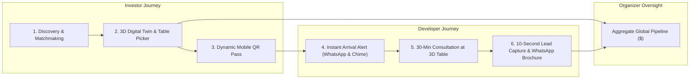

# Autonomous Real Estate Expo & Meeting Management Platform
## UI/UX Design System & 3D Table Visualizer Specification
*100% Self-Contained Standalone Operating System with Three.js/WebGL Digital Twin*

---

## 1. System Ecosystem & Seamless Lifecycle Synergy

The UI/UX across all three portals (Customer, Developer, and Organizer Admin) is designed to operate as a frictionless feedback loop featuring an **interactive 3D Digital Twin** for table exploration and booking.

---

## 2. 3D Spatial Digital Twin & Table View Experience

### 2.1 Visual Design & Luxury Real Estate Aesthetics
- **Theme**: Obsidian slate surfaces (`#0B1120`), marble floor grids with subtle gold Cartesian lines, and semi-transparent frosted acrylic booth partitions.
- **3D Table Elements**:
  - Cylindrical meeting pedestals with 4 floating executive armchair meshes.
  - Floating 3D holographic badges hovering directly above each table:
    - 🟢 `T-1 ● AVAILABLE` (Emerald green aura, ready for instant selection)
    - 🔵 `T-2 ● OCCUPIED (18m left)` (Sapphire blue with pulsing concentric arrival wave)
    - 🟡 `T-3 ● RESERVED` (Amber glow, locked for upcoming consultation)
    - 🟣 `T-4 ● RECYCLED (Walk-in Ready)` (Purple accent indicating freed no-show table)
  - Hover-Only Table Labels: Floating labels and status pills remain invisible by default to prevent visual clutter, smoothly animating into view only when the cursor hovers directly over that specific table.
  - Strict Zone Table Isolation: When filtering by specific zones (Zone 1 East, Zone 2 Central, Zone 3 West, Zone 4 North, or VIP Lounge B67), all non-matching tables are completely hidden, and raycasting is strictly restricted to visible tables.
- **Un-mirrored Coordinate Orientation**: The architectural floorplan (`hall3_floorplan.jpeg`, $88\text{m} \times 55\text{m}$, 67 booths B1–B67) is mapped upright so Arabic typography and entrance signage read naturally from right-to-left upright. Manual `[🪞 Flip X]` and `[🪞 Flip Y]` toggles are available on the 3D toolbar.

---

## 3. Complete Screens (Sub-Views) Directory

Across the platform, there are **13 dedicated, self-contained sub-views**:

### 3.1 Customer / Investor Portal (`portal-customer`)
1. **`c-view-browse` (Explore & Matchmaking)**: Filter developers by location (New Cairo, New Capital, North Coast, Red Sea) and asset class (Luxury Villas, Commercial, Apartments). Features 1-click consultation booking and "View on 3D Twin" camera focus.
2. **`c-view-3d` (Hall 3 3D Digital Twin)**: Fullscreen WebGL spatial canvas with 50 interactive tables, camera angle presets (45°, Top-Down, First-Person), presentation modes (2D Blueprint Texture Projection, 3D Pop-up Walls, Hologram Grid), and selective zone filtering.
3. **`c-view-agenda` (My Agenda & Consultations)**: Chronological card list of confirmed and pending meetings with 1-click calendar download (.ics), in-place rescheduling, cancellation with instant table recycling, and 3D map navigation.
4. **`c-view-pass` (Dynamic Fast-Track QR Pass)**: High-security fast-track pass with dynamic QR code, real-time countdown timer, "I Have Arrived" WhatsApp arrival alert trigger, Apple/Google Wallet integration, and offline PDF download.

### 3.2 Developer / Exhibitor Portal (`portal-developer`)
1. **`dev-view-schedule` (Booth Tables & Live Desk)**: Live occupancy grid for booth tables (T1–T4) with countdown timer, active session conclude button, spontaneous walk-in seating, and inbound meeting requests queue with Approve, Counter-Propose, and Decline actions.
2. **`dev-view-crm` (Native Expo CRM & Pipeline)**: Full lead management table with ratings (HOT/WARM/COLD), deal sizes ($), stages, assigned reps, 1-click CSV export, manual offline lead entry, and detailed session audit timelines.
3. **`dev-view-analytics` (Booth Analytics & Heatmap)**: Real-time table turnover velocity (sessions/table/day), average duration (mins), qualification rate (%), 8-hour table occupancy heatmap (10:00–18:00 across Tables 1–4), and sales rep leaderboard.
4. **`dev-view-team` (Sales Rep Roster)**: Management cockpit for booth consultants (Tariq, Sarah, Elena, Mostafa) with real-time table assignment dropdowns, WhatsApp contacts, and duty presence toggles.

### 3.3 Organizer / Super Admin Center (`portal-admin`)
1. **`adm-view-pulse` (Venue Pulse & Real-Time Oversight)**: Global venue KPIs (Total meetings, live in-session, VIP occupancy, declared pipeline), zone capacity gauges, live master meetings priority desk, and emergency omnichannel venue broadcast.
2. **`adm-view-master-meetings` (Master Meeting Ledger)**: Live database table tracking all 50 tables across Hall 3 with filters (ALL, IN_PROGRESS, RESERVED, FREE, RECYCLED), live search bar, session audit modals, and emergency force-free overrides.
3. **`adm-view-vip-lounge` (Central VIP Executive Lounge Operations)**: Cockpit for Booth B67 and private negotiation Pods 1 & 2 (Tables T49 & T50) with 25-seat capacity gauge, active VIP roster, "+ Admit VIP Guest" modal, and 1-click hospitality concierge dispatch (Espresso, Champagne, Legal NDA, Limousine).
4. **`adm-view-builder` (Floorplan Visualizer & CAD)**: Interactive 2D/3D floorplan visualizer with Hall 3 booth configurations (B1–B67), blueprint CAD/SVG upload, new booth partition tool, and GeoJSON export.
5. **`adm-view-notifications` (Omnichannel Gateway)**: Standalone integration center for Meta WhatsApp Cloud API and Twilio SMS fallback with live transactional dispatch log, instant retry mechanism, and test webhook payload simulator.

---

## 4. Complete Modals (Dialog Screens) Directory

The platform includes **16 comprehensive, interactive modal screens**:

| Modal ID | Purpose | Portal | Key Interactive Actions |
|---|---|---|---|
| `bookingModal` | Schedule Consultation | Customer | Select day, time slot, specialist rep; generates pass & reserves 3D table |
| `dealModal` | Conclude Session & Log Deal | Developer | Rate lead, input deal size ($), log private notes, instant WhatsApp brochure send |
| `modal-walkin-seat` | Immediate Walk-In Seating | Developer | Enter visitor name, phone, budget tier, select T1/T4, start 30m countdown |
| `modal-counter-propose` | Propose Alternative Slot | Developer | Counter with new day/slot/table and send WhatsApp offer to investor |
| `modal-dev-decline` | Polite Rejection & Redirect | Developer | Select decline reason and dispatch courteous WhatsApp notice |
| `modal-cancel-meeting` | Cancel Consultation | Customer | Select reason, immediately release table in 3D, alert rep via WhatsApp |
| `modal-reschedule` | Reschedule Consultation | Customer | Pick new day/slot without cancelling, updates pass & calendar |
| `modal-calendar-export` | Personal Calendar Sync | Customer | Download universal `.ics` file or open pre-filled Google Calendar event |
| `modal-add-lead` | Register Offline Lead | Developer | Add manual walk-in prospect to CRM pipeline and send WhatsApp welcome kit |
| `modal-lead-audit` | Session & Lead Audit Trail | All Portals | Step-by-step timestamped lifecycle (Booking -> Pass -> Arrival -> Deal) |
| `modal-force-free` | Force Free Abandoned Table | Admin | Unlock PostgreSQL `btree_gist` constraint and recycle table for walk-ins |
| `modal-vip-accredit` | Admit & Accredit VIP Guest | Admin | Accredit HNWI guest, assign Pod 1/2 in Booth B67, page hospitality concierge |
| `modal-emergency-broadcast`| Venue-Wide Alert | Admin | Blast urgent announcement across WhatsApp, SMS & booth chimes |
| `modal-blueprint-upload` | Upload Blueprint CAD/SVG | Admin | Upload architectural blueprint and re-project ground dimensions (88m × 55m) |
| `modal-booth-builder` | Partition New Booth Space | Admin | Define booth code, zone, dimensions ($8\text{m} \times 6\text{m}$), and meeting tables count |
| `modal-test-notification` | Test Notification Webhook | Admin | Preview Meta Cloud API JSON payload and dispatch simulated message |

---

## 5. Omnichannel Floating Toast System

- Container: `#toastContainer` fixed at top-right viewport.
- 5 Visual Brand Types:
  - `whatsapp`: Emerald green theme with WhatsApp icon and delivery timestamp.
  - `success`: Teal/emerald accent with action confirmation.
  - `warning`: Amber alert badge for table recycling and cancellation notices.
  - `danger`: Crimson badge for emergency broadcasts and administrative overrides.
  - `info`: Sapphire blue badge for calendar exports and roster reassignments.

---
*UI/UX Design Specification v4.0 | Fully Verified Standalone Expo OS Standard*
