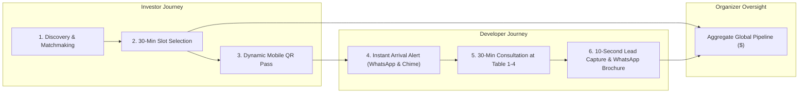

# Autonomous Real Estate Expo & Meeting Management Platform
## UI/UX Design System & Lifecycle Interaction Specification
*100% Self-Contained Standalone Operating System (Zero External Integrations Except Notifications)*

---

## 1. System Ecosystem & Seamless Lifecycle Synergy

The UI/UX across all three portals (Customer, Developer, and Organizer Admin) is designed to operate as a frictionless feedback loop where no user journey encounters a dead end.



---

## 2. Portal 1: Customer / Investor Portal (End User)

### 2.1 User Goals & Psychology
- **Target Audience**: Ultra-High-Net-Worth Individuals (HNWIs), institutional fund buyers, family offices, and retail property investors.
- **Key UX Need**: Ultra-fast discovery, zero login fatigue (OTP / magic link), instant 30-second booking, and clear spatial guidance to find booths in massive convention halls.

### 2.2 Screen-by-Screen User Flow

#### Screen 1.1: Intelligent Matchmaking Feed
- **Header**: Live Expo badge, currency selector (`USD`, `AED`, `EUR`, `GBP`), and language toggle (`English` / `العربية`).
- **Filter Pills**:
  - Asset Classes: `[All]` `[Luxury Waterfront Villas]` `[Off-Plan Towers]` `[Commercial Offices]` `[Land Plots]`
  - Budget Brackets: `[<$500K]` `[$500K - $1.5M]` `[$1.5M - $5M]` `[$5M+ HNWI]`
- **Developer Card**:
  - Developer brand badge, verified partner tier, booth number (e.g., *Hall 1 • Booth B-14*).
  - Highlighted flagship project with projected rental yield (ROI %).
  - Live table availability chip: e.g., `● 4 Reps Active Today`.
  - Primary CTA: **`[Schedule 1-on-1 Consultation]`**.

#### Screen 1.2: 3-Step Interactive Booking Drawer
- **Step 1 (Day Selector)**: Segmented control for Expo Day 1, Day 2, Day 3.
- **Step 2 (Specialist Selection)**: Dropdown or avatar chips to choose a specialist (e.g., *Luxury Villa Specialist*, *Golden Visa Residency Advisor*).
- **Step 3 (Location Option)**:
  - `[Booth Table]` (Default: seated directly at developer booth).
  - `[Central VIP Lounge]` (Quiet, confidential audio-isolated lounge for high-value negotiations).
- **Step 4 (30-Minute Time Slot Grid)**:
  - Interactive chips: Morning (10:00 - 13:00) & Afternoon (14:00 - 18:00).
  - Visual states: Clean white (available), Champagne Gold (selected), Dimmed with lock (booked).
- **Submission**: Immediate confirmation modal with automated calendar sync (`.ics` / Google / Apple Wallet).

#### Screen 1.3: "My Expo Agenda" Hub
- Chronological list of upcoming and completed sessions.
- Status badges: `CONFIRMED (Green)`, `PENDING REVIEW (Amber)`, `COMPLETED (Gray)`.
- Direct 1-tap navigation button: **`[Show Walking Route to Booth]`**.

#### Screen 1.4: Dynamic Anti-Fraud QR Pass
- **Visual Anatomy**: Luxury card styling with gold accent header.
- **Dynamic Security**: Time-based QR token regenerating every 60 seconds with anti-screenshot pulsing border.
- **Session Countdown**: Large indicator: *"Starts in 12 minutes"*.
- **The "I Have Arrived" Trigger**:
  - A prominent full-width button: **`[🔔 I Have Arrived at the Booth]`**.
  - Tapping this instantly pushes an audible chime and WhatsApp alert to the assigned representative’s tablet.

---

## 3. Portal 2: Real Estate Developer / Exhibitor Portal

### 3.1 User Goals & Psychology
- **Target Audience**: Developer Sales Directors, Marketing Managers, and on-site Booth Sales Agents.
- **Key UX Need**: Maximum lead capture speed, zero table downtime, instant notifications when investors arrive, and native CRM tracking without opening third-party spreadsheets.

### 3.2 Key Views & Features

#### Screen 2.1: Booth Table Grid & Timeline (The Command Board)
- **Top Metrics Bar**: Total Today (12), Inbound Pending (2), On-Site Waiting (1), Pipeline Value ($14.8M).
- **Table Partition Grid (Tables 1 - 4)**:
  - **Table 1**: `AVAILABLE` (Ready for next booking or walk-in).
  - **Table 2**: `INVESTOR AT TABLE NOW` (Blue highlight, countdown timer showing 18 mins left).
  - **Table 3**: `RESERVED @ 15:00` (Assigned to Rep Elena).
  - **Table 4**: `RECYCLED WALK-IN` (Green indicator: previous session marked no-show, freed for immediate walk-in guest).

#### Screen 2.2: Inbound Requests Review Queue
- Displays investor tier (*HNWI Family Office*), declared investment budget (*$4.2M*), and preferred language (*Arabic & English*).
- Action buttons:
  - **`[✓ Approve & Assign Table 1]`** (1-click confirmation; sends pass to investor).
  - **`[Propose Alternate Slot]`** (Offers alternative times without outright declining).
  - **`[Decline]`** (Opens brief polite rejection reason selector).

#### Screen 2.3: Live Consultation Console & Timer
- Audio chime sounds when investor scans at the booth table.
- A 30-minute visual countdown clock runs on the sales agent's screen.
- **5-Minute Wrap-Up Warning**: At minute 25, an amber indicator flashes gently, cueing the representative to conclude discussions and prepare for the next guest.

#### Screen 2.4: 10-Second Lead Capture Dialog (Native CRM)
- Concluding the meeting opens a streamlined modal:
  1. **Lead Score**: `HOT 🔥` (ready to book/SPA), `WARM ☀️` (comparing developers), `COLD ❄️` (unqualified).
  2. **Estimated Deal Value ($)**: Quick slider or number field (e.g., *$2,500,000*).
  3. **Interested Projects**: Checkboxes of developer projects discussed.
  4. **Next Step**: Follow-up date picker + action selector (*Site visit, send floorplan, prepare contract*).
  5. **Auto-Send Collateral Checkbox**: Pre-checked `[✓ Send High-Res Project Brochure via WhatsApp]`.
  - Tapping **`[Save Lead]`** simultaneously logs the CRM record and sends the brochure directly to the investor's phone.

---

## 4. Portal 3: Expo Organizer / Super Admin Center

### 4.1 User Goals & Psychology
- **Target Audience**: Exhibition Owners, Venue Operations Directors, VIP Lounge Concierges.
- **Key UX Need**: Real-time crowd safety and table density monitoring, master meeting dispute overrides, VIP lounge seat allocation, and aggregate financial ROI tracking.

### 4.2 Key Views & Features

#### Screen 3.1: Global Venue Pulse
- Real-time KPIs: Total Meetings (1,482), Shows vs No-Shows (94.2% show-up rate), Total Pipeline Generated ($184.5M).
- **Live Hall Heatmap**: Visual density map indicating foot traffic and table occupancy across Hall 1, Hall 2, and Lounges.

#### Screen 3.2: Native Visual Floorplan & Booth Table Builder
- Upload raw CAD/SVG floorplan blueprint.
- Interactive vector canvas:
  - Click-and-drag to draw booth polygon boundaries (e.g., Booth B-14, 96 sqm).
  - Subdivide booth interiors into **numbered tables** (Table 1 to 4).
  - Designate special zones: Central VIP Lounges, Quiet Pods, and Coffee Bars.

#### Screen 3.3: Master Meetings Audit Table
- Real-time tabular log of every meeting in the venue.
- Filter by Hall, Developer, Status (`APPROVED`, `CHECKED_IN`, `NO_SHOW`, `COMPLETED`).
- **Organizer Emergency Override**: Ability to manually reassign a delayed session to an open table or cancel disputed bookings.

#### Screen 3.4: VIP Lounge Table Concierge Console
- Tablet-optimized view for hostesses and concierges stationed at VIP Lounge entrances.
- Visual floorplan of VIP Lounges A & B (12 tables each).
- One-tap seat allocation for walk-in VIP investors who arrive without pre-booking.

#### Screen 3.5: Notification Gateway Health Monitor
- Live delivery throughput graph for WhatsApp Cloud API and Twilio SMS.
- Error log displaying undelivered messages with auto-retry toggles.

---

## 5. Design System Tokens & Multilingual Standards

```
/* Color Tokens */
--bg-midnight:        #0B1120; /* Deep Obsidian Slate */
--surface-card:       #151F32; /* Primary Component Surface */
--border-subtle:      #24324D; /* Clean Modern Border */
--accent-gold:        #D4AF37; /* Champagne Gold / Luxury Brand */
--accent-emerald:     #10B981; /* Confirmed / Active Status */
--accent-sapphire:    #3B82F6; /* Checked-In / Live Meeting */
--accent-crimson:     #EF4444; /* Hot Lead / Alert */

/* Typography */
--font-sans:          -apple-system, BlinkMacSystemFont, "Segoe UI", Roboto, sans-serif;
```

### Multilingual & RTL Rules
- Layout directions dynamically invert based on locale: `dir="rtl"` for Arabic, `dir="ltr"` for English.
- Currency amounts, booth codes (e.g., `B-14`), and table numbers (`T-2`) remain strictly internationalized for universal legibility across all languages.

---
*UI/UX Design Specification v3.1 | Autonomous Operating System*
