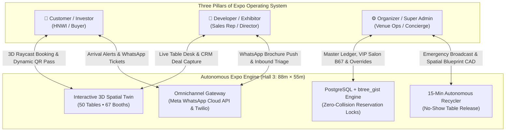
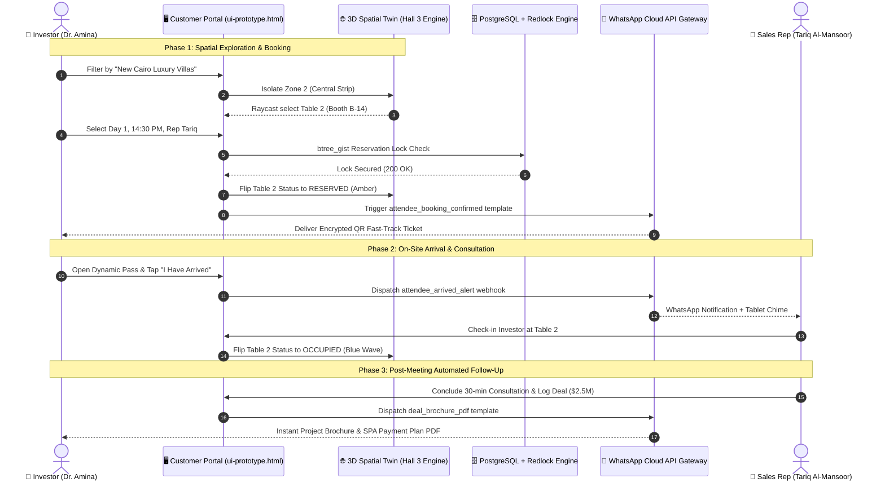
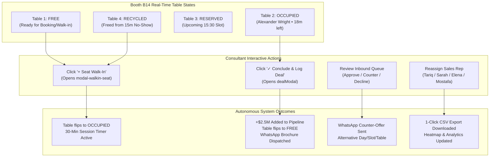
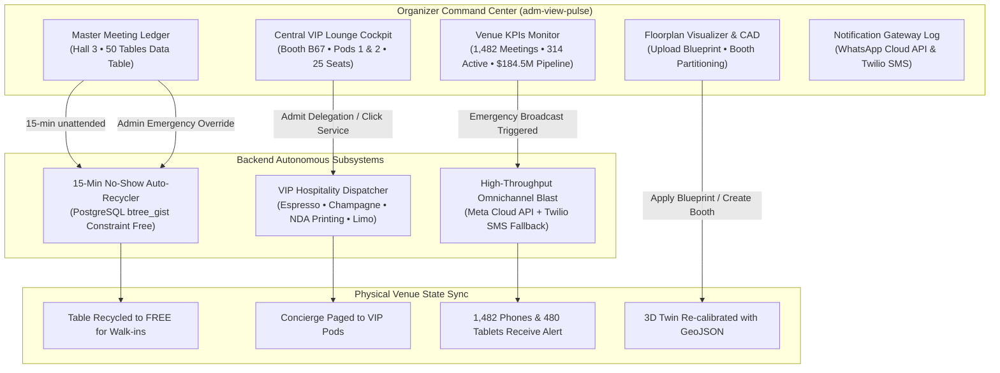

# Autonomous Real Estate Expo & Meeting Management Platform
## Role-Based User Stories, System Requirements & Architectural Diagrams
*Comprehensive Specifications for Customer / Investor, Developer / Exhibitor, and Organizer / Super Admin*

---

## 1. Executive Actor Hierarchy

The Autonomous Real Estate Expo Meeting Operating System is governed by three primary actors interacting in a closed-loop spatial and transactional ecosystem:

---

## 2. ROLE 1: CUSTOMER / PROPERTY INVESTOR

### 2.1 Persona Definition
- **Archetype**: Ultra-High-Net-Worth Individual (HNWI) & Institutional Real Estate Investor.
- **Representative Persona**: *Dr. Amina Mansouri* (Family Office Principal, $4.2M capital allocation) / *Mr. Alexander Wright* (Private Luxury Investor).
- **Core Motivations**: Discover premier developments (Palm Hills, Talaat Moustafa Group, Ora, Sodic), secure private consultations with senior decision-makers, avoid floor queues, and receive instant digital credentials on WhatsApp.
- **Frustrations with Legacy Expos**: Waiting in crowded queues at developer desks; double-booked sales reps; losing track of appointments; cumbersome app downloads and account registration friction.

---

### 2.2 Agile User Stories

#### Story 1.1: 3D Spatial Discovery & Table Raycasting
- **As a** Property Investor,
- **I want to** filter developers by location (*New Cairo, New Capital, North Coast, Red Sea*) and asset class (*Villas, Commercial, Apartments*) and navigate the Hall 3 floorplan in an un-mirrored 3D WebGL Digital Twin,
- **So that** I can visually inspect booth locations, check live table availability, and select a quiet consultation table (*e.g. Table 2 Window-Side*) before arriving.
- **Acceptance Criteria**:
  1. 3D canvas renders Hall 3 architectural floorplan ($88\text{m} \times 55\text{m}$, 67 booths B1–B67) upright with un-mirrored Arabic text.
  2. Table status pins indicate real-time state: 🟢 Available, 🔵 Occupied, 🟡 Reserved, 🟣 Recycled.
  3. Table name badges remain hidden until hovered over, preventing visual clutter.
  4. Filtering by zone (*Zone 1 East, Zone 2 Central, Zone 3 West, Zone 4 North, VIP B67*) strictly isolates matching tables and hides all others.
  5. Clicking a table immediately opens the booking drawer pre-populated with developer, booth code, and table ID.

#### Story 1.2: Instant Zero-Friction Booking & WhatsApp Pass Delivery
- **As an** Investor,
- **I want to** book a 30-minute consultation by selecting an Expo Day, time slot, and specialist consultant without creating a password-protected account,
- **So that** I secure an exclusive consultation in under 15 seconds and receive an encrypted Fast-Track QR Pass directly on WhatsApp.
- **Acceptance Criteria**:
  1. Slot selector allows picking between Day 1, Day 2, and Day 3 across 30-minute intervals.
  2. Booking execution generates a unique encrypted Pass ID (*e.g. `EXP-VIP-88194`*).
  3. Target table status in the 3D twin immediately flips to `RESERVED`.
  4. WhatsApp Cloud API simulates webhook dispatch delivering the QR pass with booth navigation coordinates.
  5. The booking is dynamically appended to the user's Agenda and the Developer's Inbound Queue.

#### Story 1.3: On-Site Fast-Track Arrival Alert
- **As an** Attendee arriving at Hall 3,
- **I want to** tap *"I Have Arrived"* on my dynamic mobile pass or scan my QR pass at the booth turnstile,
- **So that** my assigned sales consultant is alerted instantly via WhatsApp and an audible tablet chime, eliminating all reception waiting.
- **Acceptance Criteria**:
  1. Tapping *"🔔 I Have Arrived"* updates pass status to `CHECKED-IN`.
  2. A simulated WhatsApp alert is dispatched to Sales Rep Tariq Al-Mansoor: *"Investor has arrived at Booth B14 (Table 2)"*.
  3. Dynamic pass displays real-time countdown to session start.
  4. One-click buttons allow saving pass to Apple/Google Wallet or downloading an offline PDF pass.

#### Story 1.4: In-Place Agenda Rescheduling & Cancellation
- **As an** Investor with a changing expo itinerary,
- **I want to** reschedule my consultation time or cancel in one click with universal `.ics` calendar sync,
- **So that** my personal calendar stays aligned and my cancelled table is immediately released for other attendees.
- **Acceptance Criteria**:
  1. Clicking *"Reschedule"* opens a modal allowing selection of a new slot without cancelling first.
  2. Clicking *"Cancel"* triggers a confirmation modal with cancellation reasons.
  3. Confirming cancellation unlocks the PostgreSQL constraint and flips the 3D table back to `FREE` instantly.
  4. Clicking *"📅 Download Calendar Invite"* generates a universal `.ics` file blob for Apple/Outlook/Google Calendar.

---

### 2.3 Role 1 Lifecycle Diagram (Investor Journey)

---

## 3. ROLE 2: DEVELOPER / EXHIBITOR (SALES CONSULTANT & BOOTH DIRECTOR)

### 3.1 Persona Definition
- **Archetype**: Senior Exhibitor Sales Consultant & Enterprise Booth Director.
- **Representative Persona**: *Tariq Al-Mansoor* (VIP Sales Director, Emaar / Palm Hills) & *Sarah Jenkins* (Senior Luxury Advisor).
- **Core Motivations**: Maximize consultation table turnover, eliminate empty table time caused by no-shows, triage high-budget investors, and capture lead notes and SPA contracts in under 10 seconds.
- **Frustrations with Legacy Expos**: Empty tables while pre-booked visitors fail to show up; lost paper lead forms; manual, delayed collateral follow-ups taking days; lack of visibility into booth consultant conversion rates.

---

### 3.2 Agile User Stories

#### Story 2.1: Live Table Status & Real-Time Consultation Desk
- **As a** Developer Booth Director,
- **I want to** monitor our 4 dedicated booth tables (*Tables 1 to 4*) with live visual color-coded status badges and session countdown timers,
- **So that** I know exactly which tables are in consultation, which are reserved, and which are available for walk-in seating.
- **Acceptance Criteria**:
  1. Active consultation card displays remaining time (*e.g. "⏳ 18 mins left"*).
  2. Free tables display next scheduled arrival time.
  3. Recycled tables clearly show *"RECYCLED NO-SHOW (AVAILABLE NOW)"*.
  4. Real-time sync matches state with the 3D twin canvas.

#### Story 2.2: Spontaneous Walk-In Seating Modal
- **As a** Sales Consultant with an available or recycled table,
- **I want to** click *"+ Seat Walk-In"*, input the visitor's name, phone, budget tier, and launch an immediate 30-minute consultation timer,
- **So that** spontaneous high-value walk-ins are seated without delay and logged into the pipeline.
- **Acceptance Criteria**:
  1. Clicking *"+ Seat Walk-In"* opens `modal-walkin-seat` displaying target table code (*T-1 or T-4*).
  2. Input fields include Full Name, WhatsApp Mobile, Budget Range ($1M to $5M+), and Target Project.
  3. Confirming seating immediately flips table status to `OCCUPIED` in both the desk and 3D twin.
  4. Automatically prepends a new active session entry into the native CRM pipeline.

#### Story 2.3: Inbound Request Triage & Counter-Proposal Workflow
- **As a** Sales Director reviewing inbound consultation requests,
- **I want to** evaluate the visitor's declared budget allocation and choose to Approve, Counter-Propose an alternative slot, or politely Decline,
- **So that** our senior specialists' time is allocated to the highest-priority transactions without leaving other investors unattended.
- **Acceptance Criteria**:
  1. Inbound request card displays investor tier (*e.g. "HNWI FAMILY OFFICE - $4.2M Allocation"*).
  2. Clicking *"Approve"* assigns the table and dispatches an automated WhatsApp confirmation ticket.
  3. Clicking *"⇄ Counter"* opens `modal-counter-propose` allowing selection of alternative day, time slot (*e.g. 17:00*), table, and custom note.
  4. Clicking *"Send Counter-Offer"* dispatches an interactive WhatsApp counter-proposal with 1-click acceptance buttons.
  5. Clicking *"Decline"* opens `modal-dev-decline` to record polite reasons (*fully booked, senior rep needed*) and invite them to the open lounge.

#### Story 2.4: 10-Second Lead Capture & Instant WhatsApp Brochure Dispatch
- **As a** Sales Consultant concluding a 30-minute consultation,
- **I want to** click *"Conclude Session & Log Deal"*, record the estimated deal size ($), lead rating (*HOT 🔥 / WARM ☀️ / COLD ❄️*), and check *"Instant WhatsApp Delivery"*,
- **So that** the lead is committed to our native CRM pipeline and a high-resolution project PDF brochure is delivered to the client's phone within 3 seconds.
- **Acceptance Criteria**:
  1. Opening `dealModal` pre-fills investor name and default valuation.
  2. Selecting lead rating, deal valuation ($2,500,000), and follow-up action (*Site visit on Monday*).
  3. Saving updates the Developer Pipeline KPI (*e.g. $14.8M $\rightarrow$ $17.3M*).
  4. Frees Table 2 back to `FREE` in the live desk and 3D twin.
  5. Dispatches project brochure PDF via WhatsApp Cloud API with instant floating toast feedback.

#### Story 2.5: Native CRM Pipeline Export & Booth Analytics
- **As an** Exhibitor Sales Director,
- **I want to** export all collected leads to a formatted CSV file and inspect our hourly table occupancy heatmap and sales rep leaderboard,
- **So that** I can report daily ROI to corporate leadership and optimize rep table assignments.
- **Acceptance Criteria**:
  1. Clicking *"📥 Export Pipeline CSV"* generates and downloads `expo_leads_pipeline.csv` containing names, phones, budgets, stages, and reps.
  2. `dev-view-analytics` displays Table Turnover Velocity (*4.8 sessions/day*), Average Duration (*23.4 mins*), and Qualification Rate (*78.5%*).
  3. 8-hour Heatmap visualizes occupancy across Tables 1 to 4 from 10:00 AM to 6:00 PM.
  4. `dev-view-team` displays rep duty status with dynamic table reassignment dropdowns.

---

### 3.3 Role 2 Lifecycle Diagram (Developer Booth Workflow)

---

## 4. ROLE 3: ORGANIZER / SUPER ADMIN & OPERATIONS MARSHAL

### 4.1 Persona Definition
- **Archetype**: Exhibition Operations Director, Venue Floor Marshal & VIP Hospitality Protocol Lead.
- **Representative Persona**: *Eng. Sherif Rostom* (Expo Operations Director) & *Central VIP Lounge Concierge Lead*.
- **Core Motivations**: Maintain 100% operational throughput across all 67 booths in Hall 3 ($88\text{m} \times 55\text{m}$), enforce the 15-minute no-show table recycling policy, provide VIP salon management in Booth B67, and maintain emergency communications.
- **Frustrations with Legacy Expos**: Inability to identify table bottlenecks or abandoned booths in real time; noisy floor making PA announcements useless; physical VIP lounge congestion and unmanaged diplomatic delegations; static paper floorplans that cannot be adjusted mid-expo.

---

### 4.2 Agile User Stories

#### Story 3.1: Global Venue Pulse & Master Real-Time Meeting Ledger
- **As the** Expo Super Admin,
- **I want to** observe real-time venue KPIs (Total meetings, in-session consultations, table turnover rate, declared pipeline) and search the Master Ledger across all 50 tables,
- **So that** I have total situational awareness and can audit any consultation session on demand.
- **Acceptance Criteria**:
  1. `adm-view-pulse` displays live stats: 1,482 total meetings, 314 active in-session, 82% VIP occupancy, $184.5M pipeline.
  2. `adm-view-master-meetings` displays an exhaustive data table of all 50 tables across Hall 3.
  3. Filter chips allow isolating meetings by status: *ALL (50), IN_PROGRESS (8), RESERVED (14), FREE (26), RECYCLED (2)*.
  4. Real-time search bar filters rows instantly by attendee name, developer brand, booth code, or rep.
  5. Clicking *"Audit"* on any row opens `modal-lead-audit` displaying timestamped lifecycle history.

#### Story 3.2: 15-Minute Autonomous Recycler & Manual Force-Free Override
- **As an** Operations Floor Marshal,
- **I want** the system to autonomously flag tables where attendees have not checked in within 15 minutes of scheduled start, and provide an emergency *"Force Free"* override button,
- **So that** no booth table is held hostage by absent visitors and idle floor capacity is recycled for walk-in attendees.
- **Acceptance Criteria**:
  1. If attendee check-in is not registered by $T+15\text{ minutes}$, the PostgreSQL engine flags the slot as `NO_SHOW`.
  2. Table status automatically shifts to `RECYCLED` and turns purple/free on the 3D map.
  3. Clicking *"⚡ Emergency Force Free"* on any stuck table opens `modal-force-free`.
  4. Confirming override unlocks the PostgreSQL `btree_gist` constraint, frees the table in the 3D twin, and increments the Recycled Tables counter.

#### Story 3.3: Central VIP Executive Lounge Operations (Booth B67 & Pods 1–2)
- **As the** VIP Lounge Protocol Director,
- **I want to** manage the confidential VIP Executive Lounge (Booth B67, $8\text{m} \times 4\text{m}$, Tables T49 & T50) with a 25-seat capacity gauge, accredit sovereign delegations, and dispatch 1-click hospitality services,
- **So that** sovereign wealth funds and ultra-HNWI investors conduct multi-million dollar acquisitions in private comfort.
- **Acceptance Criteria**:
  1. `adm-view-vip-lounge` displays real-time capacity gauge (*20 / 25 seats occupied, 80%*).
  2. Pod 1 (Table T49) and Pod 2 (Table T50) display current delegation occupants and discussion stages (*e.g. SPA Signing*).
  3. Clicking *"+ Admit / Accredit VIP Guest"* opens `modal-vip-accredit` to record delegation name, tier, and assign Pod 1 or Pod 2.
  4. One-click concierge dispatch buttons trigger staff paging for *Artisan Espresso, French Champagne, Legal Notary / NDA Printing, and VIP Limousine Escort*.

#### Story 3.4: Emergency Omnichannel Venue Broadcast
- **As the** Expo Operations Director,
- **I want to** compose an urgent announcement and broadcast it simultaneously across WhatsApp Cloud API and Twilio SMS fallback to all 1,482 visitors and 67 booths,
- **So that** critical keynote announcements, protocol movements, or logistical updates reach all participants within 3 seconds regardless of hall noise.
- **Acceptance Criteria**:
  1. Clicking *"📢 Emergency Broadcast"* opens `modal-emergency-broadcast`.
  2. Audience selector supports *All 1,482 Attendees, All 67 Exhibitor Booths (480 Reps), or Entire Hall 3*.
  3. Confirming broadcast simulates simultaneous Meta WhatsApp API blast and Twilio SMS dispatch.
  4. Appends a broadcast event entry to the Notification Gateway log with delivered receipt timestamps.
  5. Displays a high-visibility crimson toast across all active terminals.

#### Story 3.5: Blueprint CAD/SVG Ingestion & Layout GeoJSON Export
- **As the** Venue Technical Director,
- **I want to** upload architectural CAD/SVG blueprints, partition new booth spaces with meeting tables, and export layout GeoJSON,
- **So that** the 3D digital twin continuously synchronizes with on-the-ground physical booth changes.
- **Acceptance Criteria**:
  1. `modal-blueprint-upload` accepts CAD DXF, SVG, and JPEG floorplans with scale calibration ($88\text{m} \times 55\text{m}$).
  2. `modal-booth-builder` allows creating new booth spaces (*e.g. Booth B-68, $8\text{m} \times 6\text{m}$*) with 1 to 4 tables.
  3. Clicking *"🗺️ Export GeoJSON"* generates and downloads `hall3_blueprint.geojson` containing full coordinate polygons and table metadata.

---

### 4.3 Role 3 Lifecycle Diagram (Super Admin Orchestration)

---

## 5. Cross-Role Interaction Matrix

| Scenario / Action | Customer Experience | Developer / Exhibitor Action | Super Admin Visibility |
|---|---|---|---|
| **1. Online Booking via 3D Twin** | Selects table on 3D twin; receives WhatsApp Fast-Track pass & `.ics` invite | Inbound request appears in live queue with declared budget tier | Recorded in Master Ledger as `RESERVED`; table status locked in 3D |
| **2. Inbound Counter-Offer** | Receives WhatsApp counter-proposal with alternative day/slot and 1-click buttons | Clicks *"⇄ Counter"* in queue to propose alternative table/slot | Meeting status updated to `COUNTER-PROPOSED` in master ledger |
| **3. On-Site Physical Arrival** | Taps *"I Have Arrived"* on Dynamic Pass; sees live countdown | Tablet plays audible chime; WhatsApp alert notifies assigned rep | Check-in timestamp logged; status flips to `CHECKED-IN` |
| **4. Spontaneous Walk-In** | Walk-in visitor approaches booth without prior appointment | Rep clicks *"+ Seat Walk-In"*, inputs details, and starts 30m countdown | Table status flips from `FREE` to `OCCUPIED` on global density map |
| **5. 15-Min Attendee No-Show** | Receives WhatsApp grace warning at 10m; table released at 15m | Table flips to `RECYCLED NO-SHOW`; rep seats waiting walk-in | Recycled tables metric increments (+1); audit log records no-show |
| **6. Post-Meeting Deal Conclude** | Receives project PDF brochure & payment plan on WhatsApp | Logs rating (*HOT*), deal value ($2.5M), and pipeline notes | Global declared pipeline increments ($184.5M $\rightarrow$ $187.0M) |
| **7. VIP Delegation Arrival** | Escorted directly to private Booth B67 Executive Pod | Rep meets delegation in private confidential pod with NDA | Concierge paged for espresso/champagne; capacity gauge updates |
| **8. Emergency Announcement** | Receives high-priority WhatsApp message & SMS fallback | Tablet chime rings with operational announcement | Broadcast dispatch metrics displayed with delivery receipts |

---

## 6. Verification & Implementation Reference

Every user story, state change, and action detailed in this specification is implemented, validated, and interactive in the single-file application:
- **Executable Prototype**: [ui-prototype.html](file:///c:/Users/omar%20salah/Desktop/the%20bestt%20expo/ui-prototype.html)
- **Synchronized Artifact**: [expo-meeting-ui-prototype.html](file:///C:/Users/omar%20salah/.gemini/antigravity/brain/726c9f6b-2a2e-4527-90ba-030257829263/expo-meeting-ui-prototype.html)
- **UI/UX Design Specification**: [UI_UX_DESIGN_SPECIFICATION.md](file:///c:/Users/omar%20salah/Desktop/the%20bestt%20expo/UI_UX_DESIGN_SPECIFICATION.md)

---
*Autonomous Real Estate Expo Operating System | Role Stories & System Diagrams v4.0*

